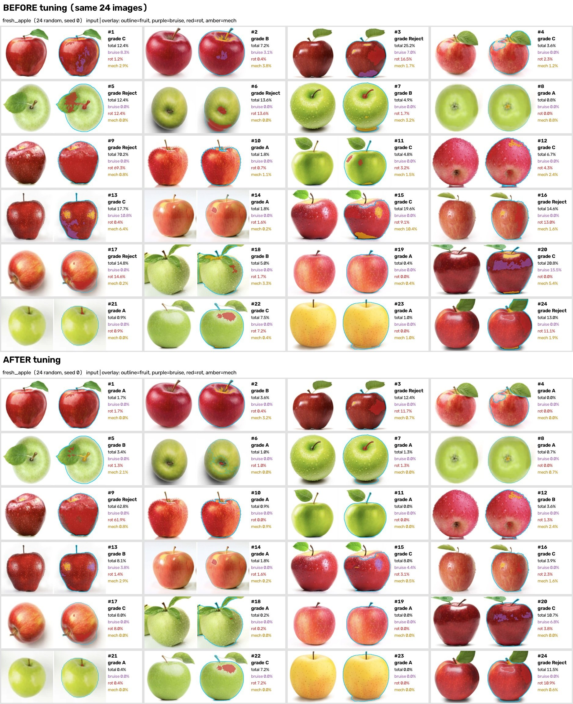
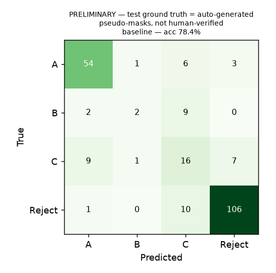
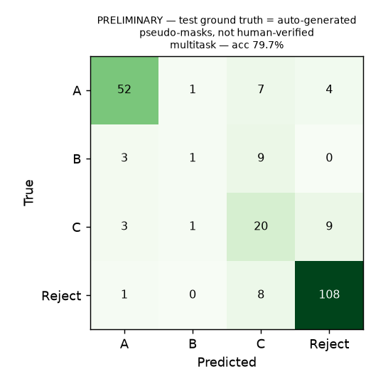
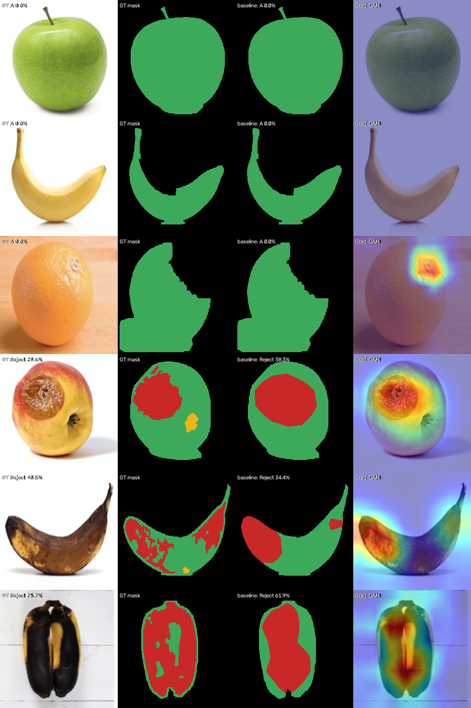
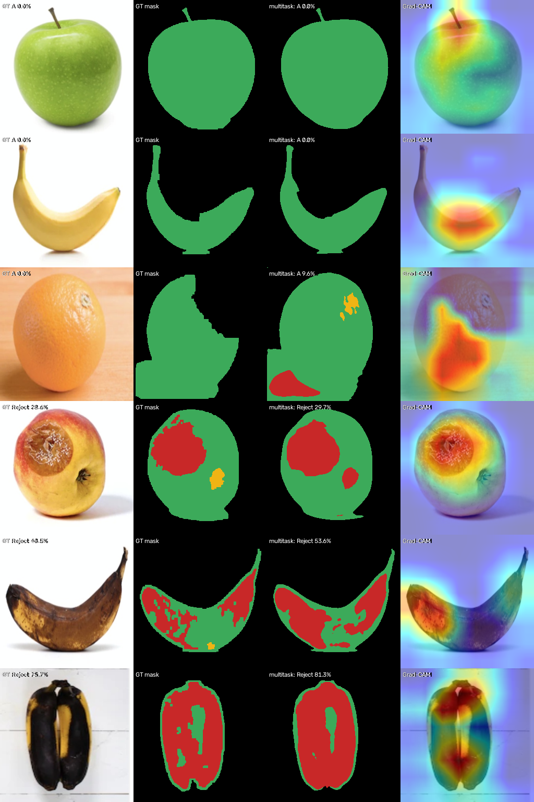
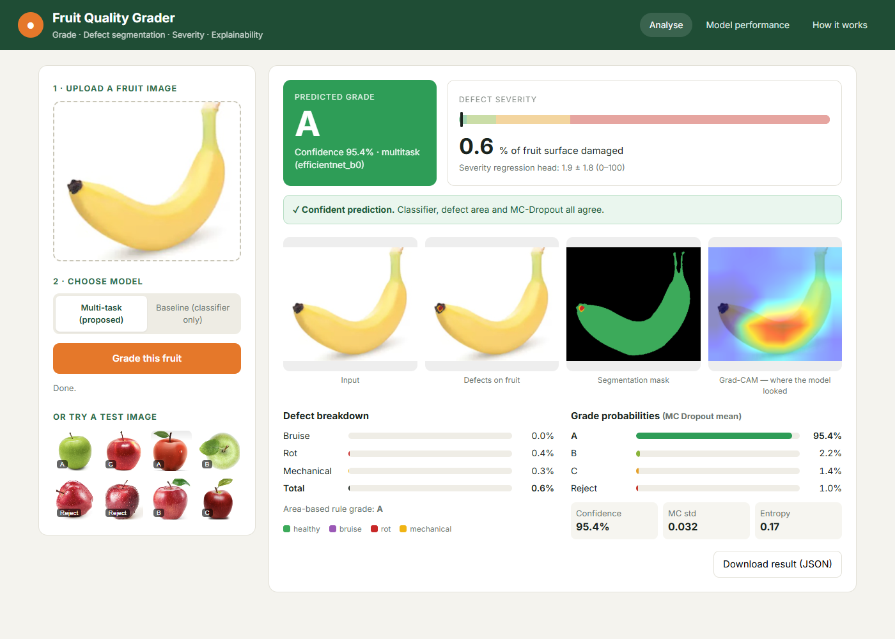
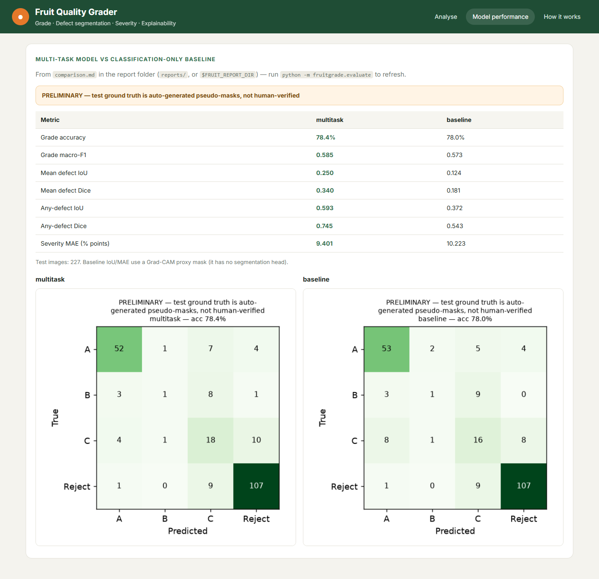
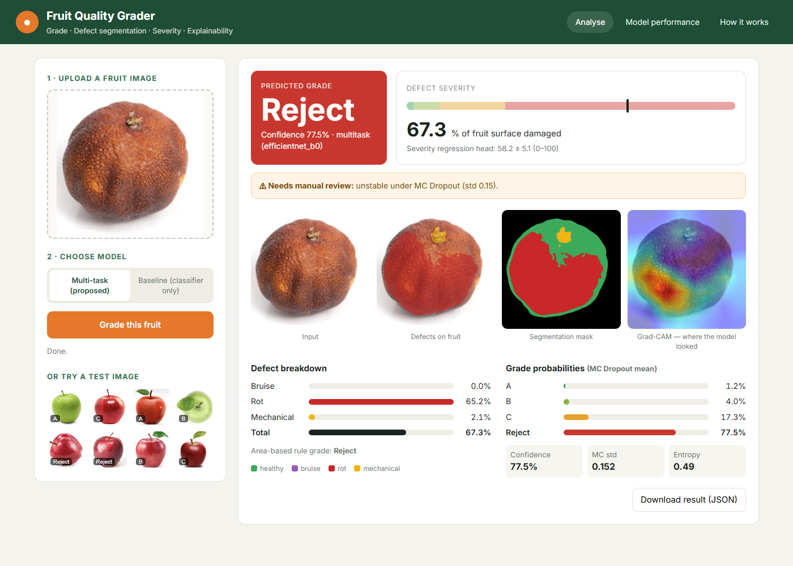
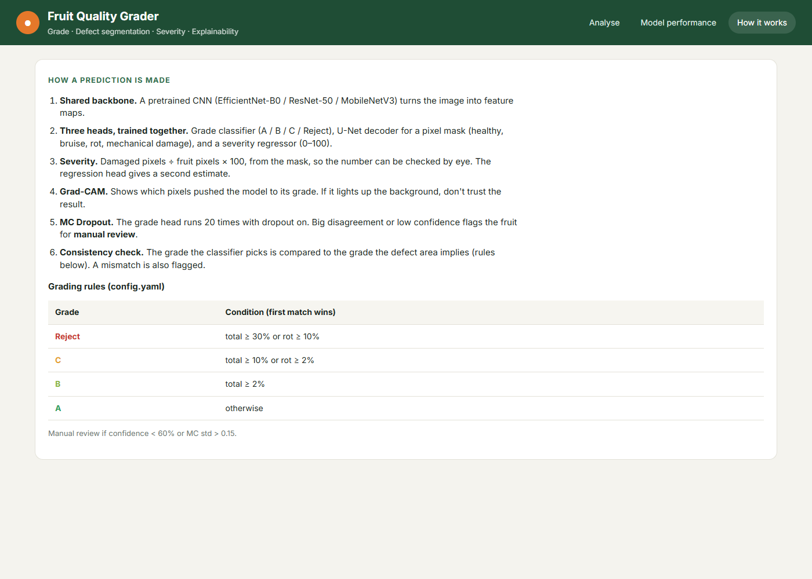

# Review pack: fruit-grader

Every number below is read from the file named next to it. Model results are **PRELIMINARY — test ground truth is auto-generated pseudo-masks, not human-verified**.

## 1. Data audit
Source: `results/data_audit/dataset_audit.json`

- Kaggle files: **13,599** = **1,511 original photos x 9 versions each** (original + rotations 15–75 deg, salt-and-pepper, shift, vertical flip).
- Augmentation counts: original 1511, rotated_by_N_ 7555, saltandpepper_ 1511, translation_ 1511, vertical_flip_ 1511.
- Kaggle's own train/test split **leaks**: versions of **1,310** of 1,511 originals sit on both sides. We do not use it.
- We use the **originals only** (1,511); all augmented copies are dropped.
- Near-duplicates: 53 candidate pairs (pHash <= 6), checked by eye; 34 merged, 0 label conflicts.
- Group split (stratified by class, seed 42): 1,478 groups; no group in two splits.

| Class | Train | Val | Test |
|---|---|---|---|
| fresh_apple | 162 | 35 | 35 |
| fresh_banana | 152 | 33 | 33 |
| fresh_orange | 144 | 31 | 31 |
| rotten_apple | 229 | 49 | 49 |
| rotten_banana | 214 | 46 | 46 |
| rotten_orange | 156 | 33 | 33 |
| **Images** | 1057 | 227 | 227 |
| **Groups** | 1037 | 220 | 221 |

- Caveat: the pseudo-mask tuning sample (240 images) was drawn from all splits (train 167, test 40, val 33).

## 2. Pseudo-masks (weak labels)



One class shown (fresh apples): `data/interim/sheets_before|after/fresh_apple.jpg`.

**Class x pseudo grade**, all 1,511 originals (source: `data/processed/labels.csv`)

| Class | A | B | C | Reject | Total |
|---|---|---|---|---|---|
| fresh_apple | 100 | 24 | 71 | 37 | 232 |
| fresh_banana | 131 | 25 | 46 | 16 | 218 |
| fresh_orange | 148 | 20 | 34 | 4 | 206 |
| rotten_apple | 5 | 0 | 45 | 277 | 327 |
| rotten_banana | 4 | 4 | 6 | 292 | 306 |
| rotten_orange | 19 | 5 | 28 | 170 | 222 |
| **All** | 407 | 78 | 230 | 796 | 1511 |

Label-consistency filter (train/val only): **71** rows excluded (fresh_label_but_reject/train 46, fresh_label_but_reject/val 3, rotten_label_but_A/train 16, rotten_label_but_A/val 6). Used for training:

| Split | A | B | C | Reject | Total |
|---|---|---|---|---|---|
| train | 265 | 46 | 158 | 526 | 995 |
| val | 56 | 19 | 39 | 104 | 218 |
| test | 64 | 13 | 33 | 117 | 227 |

## 3. PRELIMINARY — test ground truth is auto-generated pseudo-masks, not human-verified

Source: `results/preliminary/comparison.md` (copied to `preliminary/`)


## Test results (227 images, split=test, MC Dropout 20 passes, seed 0)

| Metric | multitask | baseline |
|---|---|---|
| Grade accuracy | 79.7% [74.4, 84.6] | 78.4% [73.1, 83.3] |
| Grade macro-F1 | 0.599 [0.533, 0.677] | 0.602 [0.519, 0.680] |
| Mean defect IoU | 0.250 [0.228, 0.270] | 0.124 [0.113, 0.135] |
| Mean defect Dice | 0.340 [0.315, 0.364] | 0.181 [0.169, 0.192] |
| Any-defect IoU | 0.593 [0.549, 0.636] | 0.372 [0.339, 0.404] |
| Any-defect Dice | 0.745 [0.709, 0.778] | 0.543 [0.507, 0.575] |
| Severity MAE (mask, % pts) | 9.40 [7.73, 11.09] | 10.22 [8.74, 11.72] |
| Severity MAE (regression head, % pts) | 6.67 [5.72, 7.65] | — |
| Flagged for manual review | 17.6% | 26.4% |
| Wrong grades caught by flag | 45.7% | 63.3% |
| Flagged, all app reasons (+ rule mismatch) | 26.0% | 26.4% |
| Wrong grades caught, all app reasons | 69.6% | 63.3% |

Values in brackets are 95% bootstrap confidence intervals (images resampled with replacement).
Baseline IoU/Dice/MAE use its Grad-CAM ("Reject" class, >0.5) inside the fruit as a proxy defect mask, and only as a single 'defect' class (counted as rot) — so per-type IoU is not meaningful for it.

## Paired bootstrap: multitask - baseline (1000 resamples, same images for both models)

| Metric | Difference | 95% CI | CI excludes 0? |
|---|---|---|---|
| Grade accuracy | +0.0132 | [-0.0220, +0.0441] | no |
| Grade macro-F1 | -0.0027 | [-0.0708, +0.0603] | no |
| Any-defect Dice | +0.2022 | [+0.1692, +0.2379] | yes |
| Severity MAE (mask, % pts) | -0.8213 | [-2.3228, +0.6493] | no |
| Severity MAE (multitask head vs baseline mask, % pts) | -3.5572 | [-4.9122, -2.2615] | yes |

For MAE a negative difference means the multitask model is better.

Run settings (`run_settings.json`):

```json
{
    "title":  "PRELIMINARY — test ground truth is auto-generated pseudo-masks, not human-verified",
    "commit":  "5c4d019",
    "started":  "2026-10-21T00:05:30",
    "test_ground_truth":  "pseudo-masks (auto-generated)",
    "backbone":  "efficientnet_b0",
    "pretrained":  true,
    "epochs_requested":  20,
    "early_stop_patience":  "as in config.yaml",
    "baseline":  {
                     "image_size":  256,
                     "ok":  true,
                     "batch":  8,
                     "out":  "runs/prelim_baseline_efficientnet_b0",
                     "epochs_run":  20,
                     "minutes":  47.1
                 },
    "multitask":  {
                      "image_size":  256,
                      "ok":  true,
                      "batch":  8,
                      "out":  "runs/prelim_multitask_efficientnet_b0",
                      "epochs_run":  20,
                      "minutes":  34.1
                  }
}
```









## 4. Web app (preliminary checkpoints)







